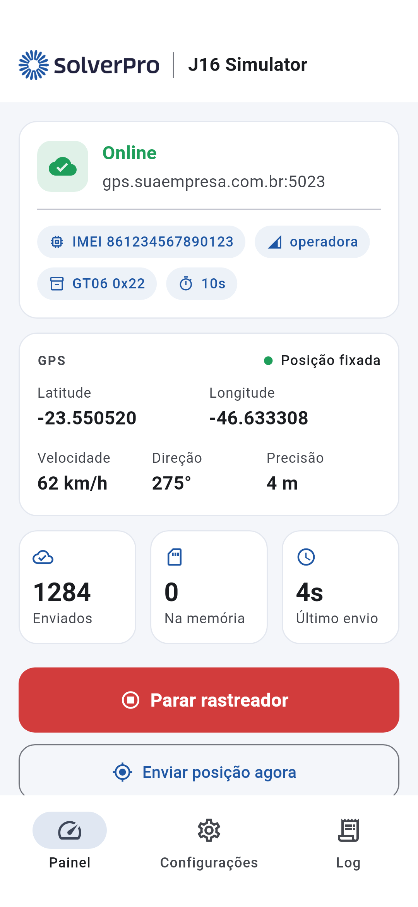
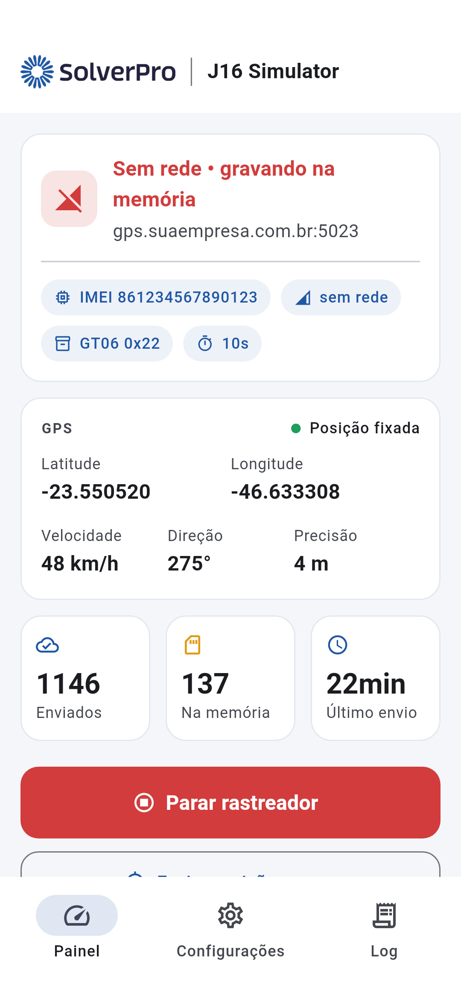
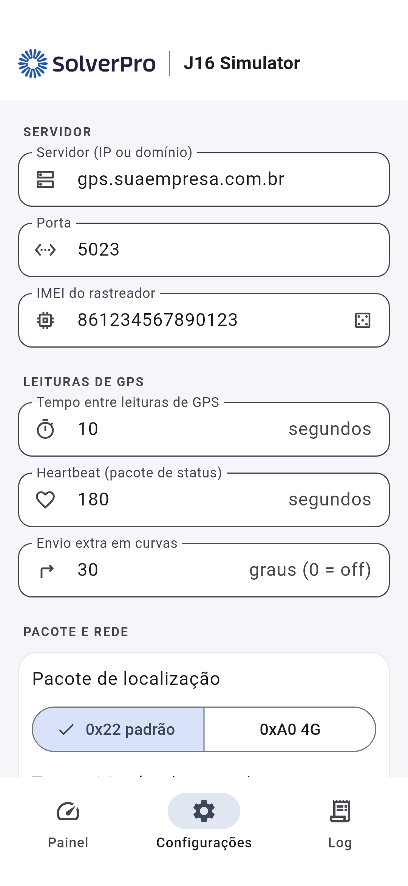
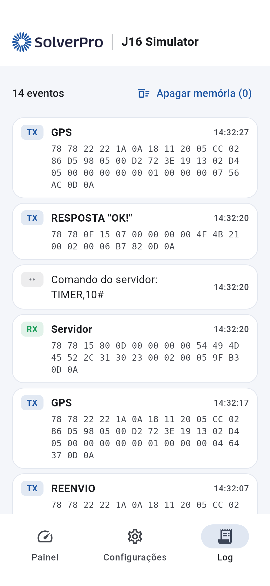

# J16 Simulator

App Flutter (Android e iOS) que transforma o celular num rastreador **J16 4G**: lê o GPS em tempo real e envia ao servidor os mesmos pacotes do aparelho (protocolo **GT06/Concox**), inclusive com a tela bloqueada e o app em segundo plano. Quando não há rede, as posições ficam guardadas na memória interna e são reenviadas quando a conexão volta.

| Painel | Sem rede | Configurações | Log |
|---|---|---|---|
|  |  |  |  |

## O que o app envia

O app abre uma conexão TCP com o servidor e se comporta como o J16:

| Pacote | Quando |
|---|---|
| `0x01` Login (IMEI em BCD) | ao conectar; espera o ACK do servidor antes de enviar dados |
| `0x13` Heartbeat (status, bateria, sinal) | a cada *Heartbeat* segundos; após 3 sem resposta, reconecta |
| `0x22` GPS+LBS (ou `0xA0` GPS+LBS 4G) | a cada *Tempo entre leituras*, e também em curvas (ângulo configurável) |
| `0x22`/`0xA0` com flag de **reenvio** | posições guardadas na memória enquanto não havia rede |
| `0x15` Resposta de texto | resposta aos comandos `0x80` do servidor |

Comandos do servidor que o app atende: `TIMER,seg#`, `HBT,min#`, `SERVER,0,host,porta,0#`, `WHERE#`, `STATUS#`, `PARAM#`, `VERSION#`, `IMEI#`, `MILEAGE#`, `RESET#`.

Sem GPS, o app repete a última posição válida marcada como inválida (igual ao aparelho). O ACC vai sempre como "ligado".

A compatibilidade foi testada num servidor **Traccar 6.16** (porta 5023, protocolo `gt06`): login, heartbeat, posições `0x22` e `0xA0`, flag de reenvio (`archive`) e resposta a comandos foram decodificados corretamente.

## Configurações

- **Servidor** e **Porta**: endereço da sua plataforma (no Traccar, porta 5023).
- **IMEI**: 15 dígitos; cadastre o mesmo IMEI na plataforma. Vem um aleatório válido, que você pode trocar.
- **Tempo entre leituras de GPS** (segundos) e **Heartbeat** (segundos).
- **Envio extra em curvas** (graus, 0 desliga).
- **Pacote**: `0x22` (padrão, compatível com qualquer plataforma GT06) ou `0xA0` (variante 4G, com LAC/Cell ID longos e hodômetro).
- **Transmitir só pela operadora**: no Wi-Fi as posições ficam na memória.
- **Iniciar automaticamente**: ao abrir o app e ao ligar o aparelho (Android).
- **Avançado**: MCC/MNC/LAC/Cell ID enviados no bloco LBS.

## Segundo plano

- **Android**: serviço em primeiro plano do tipo *location*, com notificação fixa, num isolate próprio. Continua com a tela bloqueada e mesmo se o app for fechado; religa após reiniciar o aparelho. Na primeira vez o app pede: localização ("Permitir o tempo todo"), notificações e remoção da otimização de bateria. Em celulares Xiaomi/Samsung/Motorola vale também liberar o "início automático" e deixar o app "sem restrições" de bateria.
- **iOS**: atualizações contínuas de localização em segundo plano (`UIBackgroundModes: location`), com o indicador azul na barra de status. Continua com a tela bloqueada e em segundo plano. Se o usuário fechar o app pelo multitarefa, o iOS encerra o rastreamento — é uma limitação do sistema.

## Compilar no Codemagic

O arquivo [codemagic.yaml](codemagic.yaml) tem três workflows:

| Workflow | Gera | Precisa |
|---|---|---|
| `android-release` | APK + AAB | nada; para assinar com sua chave, envie a keystore no Codemagic e descomente `android_signing` |
| `ios-release` | IPA assinado + envio ao TestFlight | conta Apple Developer e integração App Store Connect chamada `codemagic` |
| `ios-unsigned` | `Runner.app` sem assinatura | nada (só confere se o iOS compila) |

Identificadores: Android `com.solverpro.j16simulator`, iOS `com.solverpro.j16simulator`.

## Desenvolvimento

```bash
flutter pub get
flutter test                         # testes do protocolo GT06
flutter run
```

Para regenerar as imagens das telas:

```bash
flutter test tool/screenshots_test.dart --dart-define=FLUTTER_ROOT=$(dirname $(dirname $(which flutter)))
```

Estrutura:

- `lib/protocol/gt06.dart` — codificação/decodificação dos pacotes GT06 e CRC-ITU
- `lib/tracker/engine.dart` — o "aparelho": GPS, conexão, login, heartbeat, envio, memória, comandos
- `lib/tracker/queue_store.dart` — memória interna (SQLite)
- `lib/tracker/host.dart` — serviço em segundo plano Android / execução no iOS
- `lib/ui/` — telas
